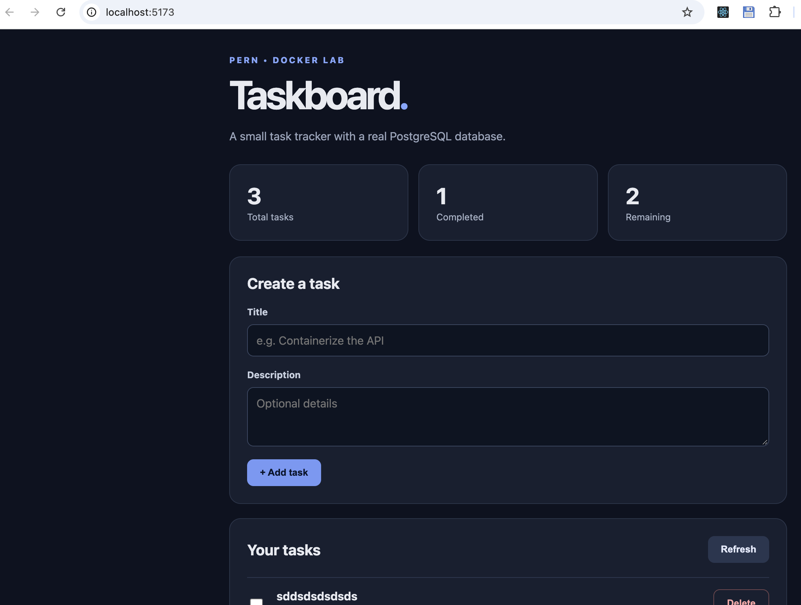

# Docker Challenge — Submission

## How to run the app

1. Clone this repository and enter the project root (the folder that contains `compose.yaml`, `client/`, and `server/`).
2. Copy the environment example file:

```bash
cp .env.example .env
```

3. Start all three services:

```bash
docker compose up --build -d
```

4. Open the frontend: [http://localhost:5173](http://localhost:5173)
5. Check API + database health:

```bash
curl http://localhost:3000/health
```

Expected response:

```json
{"status":"ok","database":"connected"}
```

6. Stop containers (keeps the named volume / task data):

```bash
docker compose down
```

### Optional: production stack

```bash
docker compose -f compose.prod.yaml up --build -d
```

- Frontend (Nginx): [http://localhost:5173](http://localhost:5173) (`FRONTEND_PORT` → container port 80)
- API: [http://localhost:3000](http://localhost:3000)

---

## Part 5 — Persistence evidence

### Screenshots

Frontend loaded with tasks at [http://localhost:5173](http://localhost:5173):



### Verification steps

1. With the stack running, opened [http://localhost:5173](http://localhost:5173) and created at least three tasks in the UI.
2. Ran `docker compose down` (without `-v`).
3. Ran `docker compose up -d`.
4. Refreshed the browser — the same tasks were still listed.

### Volume identification

```bash
docker volume ls
docker volume inspect docker-challenge_db_data
```

(The exact volume name is prefixed with the Compose project name; inspect the volume that maps to this project’s `db_data`.)

### Why a named volume preserves records

`docker compose down` removes containers and the default network, but **named volumes are kept** unless you pass `-v`. Postgres stores its data under `/var/lib/postgresql/data`, which is mounted to the named volume `db_data`. When containers are recreated on `up`, they remount the same volume, so the database files (and our tasks) are still there.

**Do not run** `docker compose down -v` unless you intend to delete that data.

---

## Part 6 — Troubleshooting findings

For each scenario: diagnosis approach, useful commands, and the fix.

### 1. Backend logs show `ECONNREFUSED` while connecting to PostgreSQL

- **Diagnose:** The API cannot open a TCP connection to Postgres. Check service status and logs; confirm `DB_HOST` and that the backend waits for a healthy database.
- **Commands:**
  ```bash
  docker compose ps
  docker compose logs backend
  docker compose logs database
  ```
- **Fix:** Set `DB_HOST=database` (Compose service name), not `localhost`. Ensure `depends_on` uses `condition: service_healthy` with a working `pg_isready` healthcheck. Confirm `DB_PORT`, `DB_USER`, `DB_PASSWORD`, and `DB_NAME` match `POSTGRES_*` on the database service.

### 2. React renders, but fetching tasks fails in the browser

- **Diagnose:** The UI loaded, but the browser cannot reach the API. Inspect the failed request URL/status in DevTools Network. Test the API from the host.
- **Commands:**
  ```bash
  curl http://localhost:3000/health
  docker compose logs backend
  ```
- **Fix:** Set `VITE_API_URL` to a **browser-reachable** URL such as `http://localhost:3000`. Do not use `http://backend:3000` in the browser (that hostname only works on the Docker network). Ensure backend `ports` publishes `3000` and the backend container is healthy.

### 3. React code changes do not appear without rebuilding the image

- **Diagnose:** Source is copied into the image at build time; the running container is not using live host files.
- **Commands:**
  ```bash
  docker compose up --build frontend
  ```
- **Fix (dev improvement):** Add a bind mount (e.g. `./client:/app`) for live editing, and mount an anonymous/named volume on `/app/node_modules` so the host does not overwrite container-installed dependencies. Otherwise rebuild when source changes.

### 4. The backend container exits immediately

- **Diagnose:** The Node process crashed on startup. Read exit status and logs for the error.
- **Commands:**
  ```bash
  docker compose ps -a
  docker compose logs backend
  ```
- **Fix:** Correct missing/invalid environment variables, Dockerfile `CMD`, or application startup errors (including hard failures if the DB is unreachable). Rebuild after Dockerfile fixes: `docker compose up --build backend`.

### 5. Host port `5432` is already in use by a local PostgreSQL installation

- **Diagnose:** Only matters if Compose publishes host port `5432`. Check what is listening locally.
- **Commands:**
  ```bash
  lsof -i :5432
  ```
- **Fix:** Prefer not publishing `5432` to the host (backend can use `database:5432` on the Compose network). Or map a different host port (e.g. `"5433:5432"`), or stop the local Postgres service.

---

## Part 7 — Docker commands demonstrated

Run from the project root (with `.env` present).

| Task | Command |
|------|---------|
| Build all project images | `docker compose build` |
| Start all services in detached mode | `docker compose up -d` |
| List running containers | `docker compose ps` |
| Follow only backend logs | `docker compose logs -f backend` |
| Open a shell in the backend container | `docker compose exec backend sh` |
| Run a SQL query inside PostgreSQL | `docker compose exec database psql -U postgres -d taskboard -c 'SELECT * FROM tasks;'` |
| Restart only the backend | `docker compose restart backend` |
| Rebuild only the frontend | `docker compose up --build -d frontend` |
| Stop/remove containers, keep DB data | `docker compose down` |
| List images / spot unused ones | `docker images` then `docker image prune` (review before confirming) |

---

## Project layout (Docker-related)

```text
client/Dockerfile
client/Dockerfile.prod          # bonus
client/.dockerignore
client/nginx.conf               # bonus
server/Dockerfile
server/Dockerfile.prod          # bonus
server/.dockerignore
compose.yaml                    # development
compose.prod.yaml               # bonus production
.env.example
SUBMISSION.md
```

---

## Bonus (completed)

- Multi-stage frontend: Node builds static assets; Nginx serves them (`client/Dockerfile.prod`).
- Backend: `npm run build` then `node dist/index.js` (`server/Dockerfile.prod`).
- Production Compose: `compose.prod.yaml`.
- Backend healthcheck on `GET /health`.
- `VITE_API_URL` passed as a **build arg** so the browser calls `http://localhost:3000`, not the internal service name.
